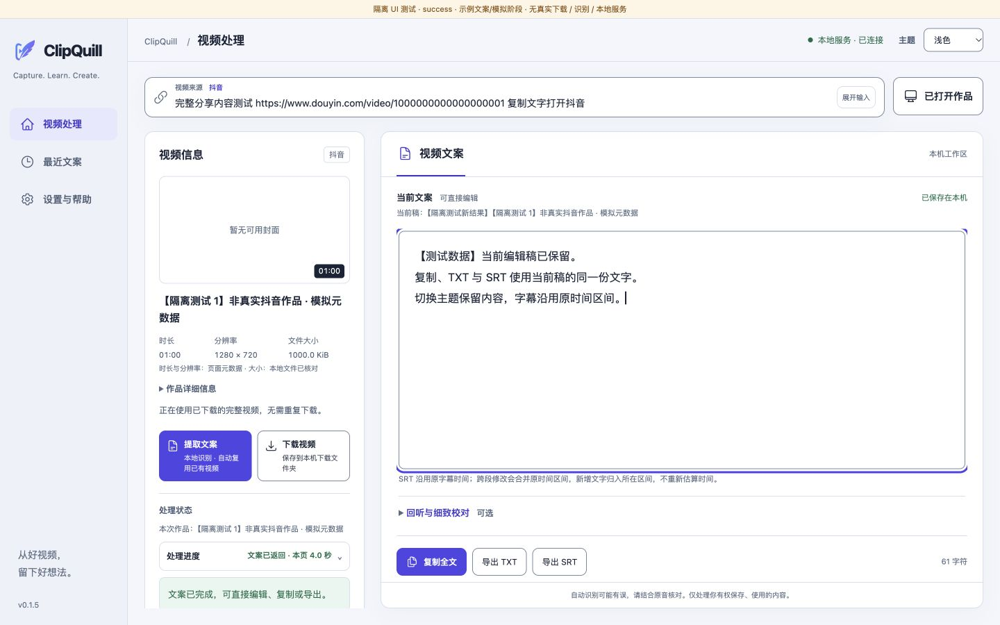
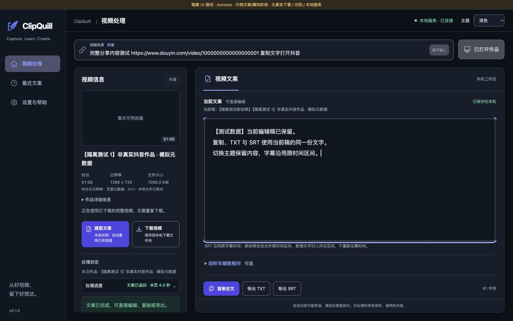
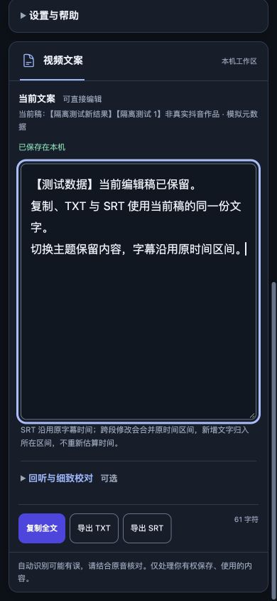

<p align="center">
  
</p>

<h1 align="center">ClipQuill</h1>

<p align="center">本地视频与文案工作台 · 从分享链接到可编辑文案与字幕</p>

<p align="center">
  Chrome Manifest V3 · 本地语音识别 · TXT / SRT · 浅色 / 深色主题
</p>

ClipQuill 将抖音视频保存、语音识别、文案编辑和字幕导出放在同一个浏览器工作区中。粘贴分享链接，或选择已打开的作品，即可下载视频；配合本地助手，还能在自己的电脑上提取文案、逐句回听和校对。

语音识别使用本机模型，无需云端语音 API 或 API Key。视频下载和首次模型安装仍需要网络。

> **当前为开发版。** 扩展源码版本为 `0.1.5`，包含后续 UI v2 改动；仓库内同版本扩展 ZIP 尚未同步最新界面。完整 macOS 助手安装包不在仓库中，克隆源码或下载扩展 ZIP 不会同时获得模型和运行环境。

[开始使用](#开始使用) · [开发与测试](#开发与测试) · [验证状态](#验证状态) · [项目文档](#项目文档)

## 能做什么

| 功能 | 说明 |
| --- | --- |
| 视频保存 | 解析分享链接或已打开的作品，选择兼容的 MP4，交给 Chrome 下载。 |
| 本地文案提取 | Qwen3-ASR 识别、ForcedAligner 时间对齐，Whisper 独立对照并提示分歧。 |
| 视频复用 | 提取前检查已下载文件的作品 ID、规格和大小，复用完整视频。 |
| 文案编辑与导出 | 编辑当前稿、复制全文、导出 TXT 或带原时间区间的 SRT。 |
| 逐句校对 | 回听原音、查看模型分歧和保存校对草稿；原始识别结果单独保留。 |
| 任务恢复 | 本地助手按需启动；支持失败重试、任务状态重查和当前稿恢复。 |
| 工作区界面 | 浅色、深色及跟随系统主题，宽屏工作区与窄窗口布局。 |

自动识别可能出错，分歧提示不等于准确率；导出前建议结合原音核对。全文编辑沿用原字幕时间区间，跨段修改会合并区间，不会重新估计时间。

## 界面预览

以下截图来自**隔离 UI 测试数据**，用于展示当前源码的布局，不代表真实抖音下载或模型任务已完成。



<details>
<summary>查看深色工作区与窄窗口编辑器</summary>





</details>

## 开始使用

### 加载源码扩展

此路径可以体验当前界面和视频下载；**提取文案需要额外配置本地助手**。

```sh
git clone https://github.com/SharkyTang/clipquill.git
cd clipquill
```

1. 在 Chrome 地址栏打开 `chrome://extensions`，开启「开发者模式」。
2. 点击「加载已解压的扩展程序」，选择仓库中的 `outputs/douyin-independent-extension` 文件夹。
3. 从扩展工具栏打开 ClipQuill，粘贴分享链接，或选择已打开的抖音作品。
4. 点击「下载视频」，文件默认保存到系统「下载 / 抖音独立导出」目录。下载期间保持工具页打开，便于查看校验结果。

遇到登录或安全验证提示时，在正常抖音页面完成操作，再回到工具重试。其他作品、未登录会话及抖音网页后续变化的兼容性仍需持续验证。

### 启用本地文案提取

完整助手安装包当前面向 **Apple Silicon Mac + macOS 26 或更新版本 + Google Chrome**。Windows、Linux 和 Intel Mac 尚未验证。

如已获得完整的 `ClipQuill-v0.1.5-mac-arm64.zip`：

1. 解压安装包，双击包内「首次安装.command」。包内包含 Python 和音频工具；首次联网下载约 **4.0 GiB** 模型，固定版本并校验 SHA-256，支持中断续传。
2. 根据安装程序打开的目录，在 Chrome 加载配对的扩展。已有用户按[安装说明](packaging/安装说明.md)保留原扩展目录和数据进行升级。
3. 打开 ClipQuill，点击「提取文案」。本地助手自动启动或复用现有服务，完成后可编辑、回听和导出。

**仓库不提供上述完整安装包的下载。** 仓库内 `douyin-independent-extension-v0.1.5.zip` 仅包含旧版浏览器扩展；`outputs/首次安装.command` 也要求本机已有解压好的完整安装包。开发者可参考[转写依赖说明](outputs/文案提取使用说明.md#开发者依赖与旧手动方式用户安装包已包含环境)准备环境；构建脚本依赖已准备的本机资源。

更新已加载的扩展时，保持原目录，在扩展管理页点击「重新加载」，再关闭旧工具页并重新打开。卸载、清除扩展存储或迁移目录前，请先导出当前稿。

## 工作流程与技术实现

```text
抖音分享链接 / 已打开作品
          ↓
Chrome 扩展解析页面、核对作品 ID
          ↓
保存视频 / 复用已下载的完整视频
          ↓
本地助手 → Qwen3-ASR → ForcedAligner 时间对齐
          ↓
Whisper 对照 → 当前稿编辑 / 逐句回听 → TXT / SRT
```

- **浏览器端**：原生 JavaScript / ES Modules、HTML 和 CSS，使用 Chrome Manifest V3。
- **伴随服务**：Python HTTP 服务，仅监听 `127.0.0.1:8766`；Native Messaging 负责按需启动，安装器负责扩展配对。
- **识别与对齐**：MLX 上的 Qwen3-ASR 1.7B 8bit 和 Qwen3 ForcedAligner 0.6B 8bit。
- **独立对照**：whisper.cpp、Whisper large-v3-turbo Q5_0 和 Silero VAD；FFmpeg / ffprobe 处理与检查音视频。
- **模型来源**：固定下载地址、版本和校验值见 [models.lock.json](packaging/models.lock.json)，Python 依赖见 [asr-requirements.lock.txt](scripts/asr-requirements.lock.txt)。

本地识别启用离线模式，视频和音频不上传至语音识别服务。伴随服务一次处理一个任务，接受下载目录内通过检查的完整 MP4，视频时长不超过一小时。安装版资源和任务结果位于当前用户的 `~/Library/Application Support/ClipQuill/`。

## 开发与测试

### 预览界面

需要 Python 3.9 或更新版本；预览不要求安装模型或本地助手。

```sh
python3 scripts/ui-preview/server.py --port 4176
```

打开 [隔离 UI 预览](http://127.0.0.1:4176/tool.html?state=complete&scenario=success)。页面带有测试横幅，链接、元数据、任务和结果均为模拟数据，不连接真实抖音或识别服务。其他状态见 [UI fixture 说明](scripts/ui-preview/README.md)。

### 运行自动检查

需要支持 `node:test` 的 Node.js 和 Python 3，无需执行 `npm install`。

```sh
node --test --test-reporter=spec scripts/extension-tests/*.test.mjs
PYTHONPATH=scripts python3 -m unittest discover -s scripts/tests -v
```

这些检查覆盖解析、任务状态、草稿保护、导出、本地服务和安装逻辑，使用模拟或隔离环境；不代替真实 Chrome、模型或跨机器安装验收。

### 目录结构

```text
outputs/douyin-independent-extension/  Chrome 扩展源码
scripts/                              本地助手、转写、安装与构建工具
scripts/extension-tests/               JavaScript 自动检查
scripts/tests/                         Python 自动检查
scripts/ui-preview/                    隔离 UI 预览与故障场景
packaging/                            安装入口、说明和固定模型清单
docs/ui-v2/                           当前 UI 实施与验证记录
outputs/*.md                          历史实测及使用文档
```

模型、运行环境、原始抓取、音视频和转写结果保留在本地，由 `.gitignore` 排除。

## 验证状态

| 范围 | 已记录的证据与边界 |
| --- | --- |
| 历史真实 Chrome 流程 | 早期版本已有本机下载、提取、编辑、导出和恢复记录；v0.1.5 的按需启动流程曾由用户在真实 Chrome 确认。 |
| 当前 UI v2 | 2026-10-15 报告记录 189 项 JavaScript、53 项 Python 检查通过，并完成部分隔离浏览器检查。 |
| 当前源码仍待验证 | 最新 UI 在真实 Chrome 中的完整流程、系统中文输入法、原音、200% 缩放及真实截图；其他电脑首次安装、签名与公证。 |

历史样本和旧版实测不能代表最新界面全部验收通过，也不构成识别准确率或处理速度保证。完整边界见 [UI v2 验证报告](docs/ui-v2/s4-s6-qa-report.md)、[验收矩阵](docs/ui-v2/s4-s6-matrix.md)及 [v0.1.5 安装与自动启动记录](outputs/自动启动与首次安装验证.md)。

## 项目文档

- [扩展使用说明与版本历史](outputs/douyin-independent-extension/README.md)
- [本地助手安装说明](packaging/安装说明.md)
- [文案提取与开发环境](outputs/文案提取使用说明.md)
- [当前 UI 实施、重载与回退](docs/ui-v2/s4-s6-implementation.md)
- [早期真实 Chrome 验收](outputs/phase-01/验收报告.md)
- [识别改进、剩余错误与样本边界](outputs/文案精度优化验证.md)
- [独立实现技术结论](outputs/独立实现技术结论.md)

## 使用范围与许可证

请仅保存和使用自己有权处理的内容。项目读取正常页面提供的媒体信息，不实现验证码绕过、付费解锁或加密媒体解密，也不承诺所有作品均可下载或无水印。

项目尚未选择整体发行许可证。第三方组件、模型和图标遵循各自许可证；分发时需保留相应声明，不能将局部资源的许可证视为整个项目的授权。Heroicons 图标声明见 [assets/ui/LICENSE](outputs/douyin-independent-extension/assets/ui/LICENSE)。
