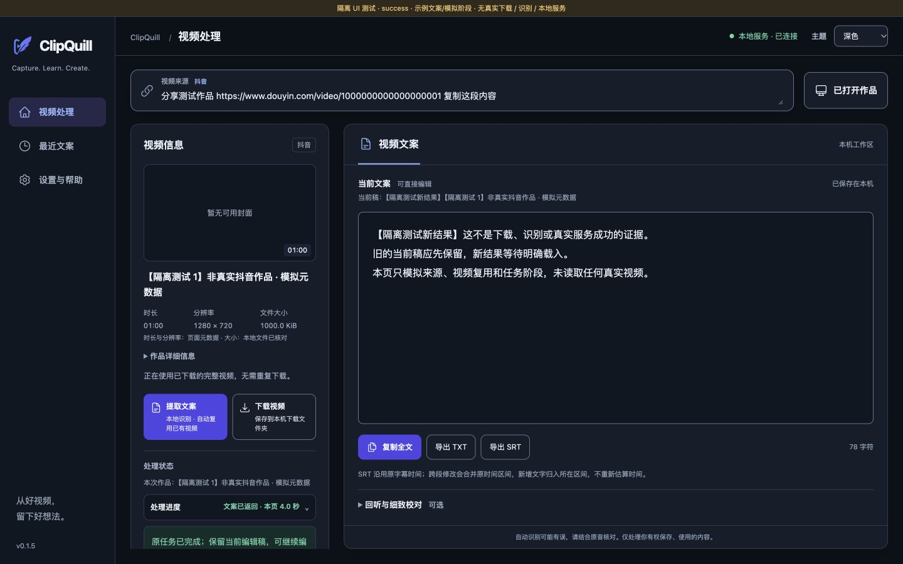
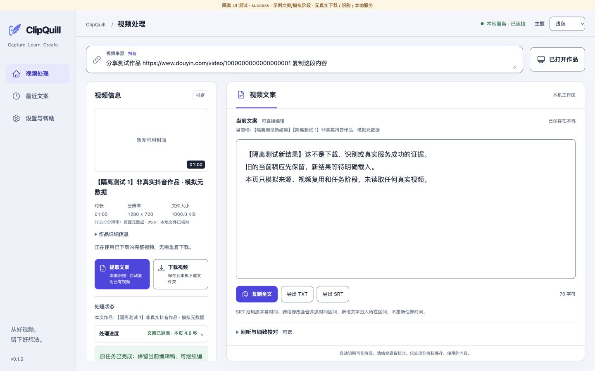
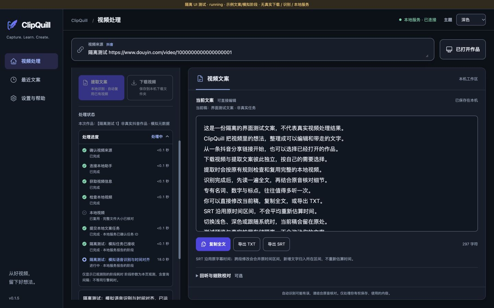
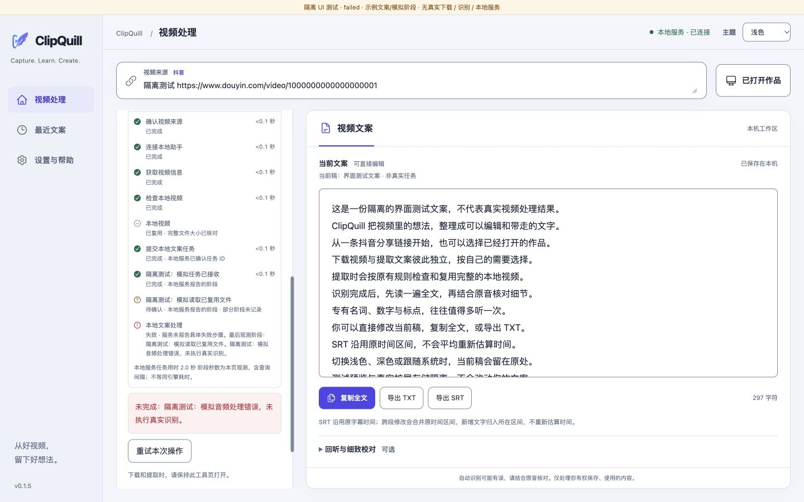

# ClipQuill UI v2 · 第一轮验证

2026-10-15（Europe/London）。**代码已接入原扩展，自动检查和隔离浏览器运行通过；真实 Chrome 扩展截图/任务验收被环境策略阻塞。S3 检查点待用户视觉反馈与真实环境补验，不能标全部完成。**

## 实际命令

| 检查 | 命令 | 结果与范围 |
| --- | --- | --- |
| JavaScript 全回归 | `node --test --test-reporter=spec scripts/extension-tests/*.test.mjs` | 174/174 通过，0 fail/cancelled/skipped；初始基线 143/143 |
| Python 全回归 | `PYTHONPATH=scripts python3 -m unittest discover -s scripts/tests -v`；修改后另跑 `-q` | 53/53 通过；未改 Python，不代表新执行真实模型任务 |
| 语法 | `node --check outputs/douyin-independent-extension/tool.js`；同样检查 `core.mjs`、`metadata.mjs`、`progress.mjs` 和 `scripts/ui-preview/fixture.js` | 全部退出 0 |
| 差异格式 | `git diff --check` | 退出 0 |
| 语义色对比 | 从实际 `tool.css` 读取 light/dark Tokens，按 sRGB 亮度计算 9 类文字色对 | light 5.43–15.73:1，dark 6.29–15.73:1；未做全页无障碍认证 |
| 运行入口 | 原有 `python3 scripts/ui-preview/server.py --port 4176` 已在运行，`lsof -nP -iTCP:4176 -sTCP:LISTEN` 确认 | 使用同一生产 HTML/CSS/模块；fixture 仅由测试服务器注入，不在生产页/manifest 引用 |

开发中第一次全量 JS 运行失败，原因是旧 VM 测试壳去掉 import 后没有注入新增模块；已更新两处测试壳并重跑。随后集成测试揭示同任务 A 的迟到状态可能覆盖 B 的通用状态，已补来源校验与回归。最终无剩余测试失败。一次浏览器等待完成文字超时后，后续 DOM 确认任务在正常第三轮模拟查询完成；没有据此修改轮询节奏。

## 本次实际浏览器观察

在 Codex 内置浏览器打开 `http://127.0.0.1:4176/tool.html?state=complete&scenario=success`，1440×900。通过页面原按钮粘贴包含文字和 URL 的完整分享内容、提取、模拟文件复用、阶段推进、完成折叠、手动展开。深/浅切换前后编辑器内容与选区值一致。running/failed 场景通过相同原按钮启动，观察到运行自动展开、失败阶段未知说明、原当前稿保留与重试入口。截图页面均有醒目的隔离测试横幅。

浏览器控制台所查 warn/error 为空。没有连接真实抖音/8766/Native Messaging，没有发起视频下载或模型推理；fixture 中的“服务已连接”“本地文件已核对”都是边界模拟，不可用于真实完成证明。封面/头像实际成功与失败/迟到通过入口 DOM 集成测试验证，截图故意使用无封面的诚实降级。

另在同一运行页将视口改为 390×844，只读检查得到 `innerWidth = documentElement.scrollWidth = body.scrollWidth = 390`，未出现整页横向溢出。这是本轮组件的窄屏冒烟检查，不能替代 S5 全矩阵。

## 运行截图：全部是测试数据

| 截图 | 实际状态 |
| --- | --- |
| [深色 1440×900](screenshots/complete-dark-1440x900-fixture.jpg) | 原入口动态完成态、视频信息、复用与折叠摘要；测试数据 |
| [浅色 1440×900](screenshots/complete-light-1440x900-fixture.jpg) | 同一任务切换主题后，当前文案与选区保留；测试数据 |
| [处理中 1440×900](screenshots/running-dark-1440x900-fixture.jpg) | 真实运行的模拟阶段，左栏滚动至阶段区，非真实模型任务 |
| [失败 1440×900](screenshots/failed-light-1440x900-fixture.jpg) | 模拟失败，真实格式错误、失败步骤未报告、旧稿保留；左栏滚动至阶段区 |

## 真实环境阻塞与下一步

发现原 Chrome 的 ClipQuill 工具标签页，但 `cua.getTab` 被浏览器安全策略明确拒绝：只允许 HTTP/HTTPS，不能观察 chrome-extension 协议，并禁止绕过。未使用其他表面、原始 CDP、外部浏览器命令或原生截图绕过。因此本轮没有重载真实扩展、没有取得新真实 Chrome 截图、没有核实其实际加载目录，未把旧图作为新证据。

人工补验应先在原 Chrome 扩展管理核实当前加载目录。若是仓库 `outputs/douyin-independent-extension`，对原扩展重载并重开工具页；不要卸载、清数据或新建身份。若加载的是 Application Support 安装副本，仓库代码不会自动同步；应另行核对原目录与配对再进行受审阅的更新，本轮没有覆盖副本。

需补验：一条真实视频的封面/作者/候选数据与缺字段降级，完整视频复用，独立下载，真实任务阶段与本地服务时间，断连原 GET 恢复，当前编辑稿复制/TXT/SRT/恢复/回听，真实深浅 1440×900 截图。系统 IME、剪贴板、撤销、窄视口/缩放和不同作品/网络兼容仍属后续 S4–S6 验收。

## 数据与安全降级

- 可选字段来自同一已核对的页面作品，安全文本渲染；未扩大权限或服务协议。
- 封面仅接受已观察到的图片域名；缺失、失败或新域名显示占位，作者缺失隐藏，头像失败隐藏。
- 分辨率/时长标注页面元数据；大小未核验前只称页面标称。
- 没有已验证视频播放路径，不显示假预览。
- 没有服务端分阶段时间，使用本页实际观测并标明含查询间隔；断线/历史缺失不补造秒数。
- 原服务只报告音频准备、合并识别/对齐等粗阶段；具体失败步骤未报告时明确未知。
- 主题/布局/阶段不持有编辑稿，不更改现有 SRT 时间规则或存储。没有提交、推送或发布。

本轮事实来源和全部修改文件理由见 [baseline.md](baseline.md) 与 [implementation-log.md](implementation-log.md)。
