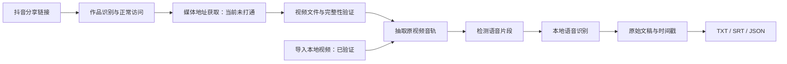

# 抖音视频下载与文案提取：独立实现结论

核查日期：2026-10-12。样本：`https://v.douyin.com/bbXEZdKRShg/`。

## 结论

两项功能可以拆成“视频获取”和“语音转写”两个独立模块，不需要复制轻抖界面或调用轻抖接口。现在已实际跑通本地视频到文稿的完整流程；原抖音链接到无水印文件的独立下载流程尚未跑通，主要卡在作品详情/媒体地址的获取。不能将此前轻抖下载成功作为独立下载成功的证据。

REA 能帮助读懂客户端代码，但不会提供抖音服务器的媒体解析能力，也不会恢复轻抖后端。继续投入轻抖前端逆向，对解决这个瓶颈的帮助有限。

## 当前证据

| 环节 | 实际结果 | 结论边界 |
|---|---|---|
| 短链接展开 | 浏览器和 yt-dlp 均识别到作品 `7689864994510343451` | 有作品编号，不等于取得媒体地址 |
| Chrome 打开作品 | 直接地址首次报错；随后通过页面可见的原作品入口打开，确认目标 ID、5 分钟播放器和 1920×1080 播放尺寸 | 原作品可在已有会话中播放；播放尺寸不等于已导出该分辨率文件 |
| 目标播放器媒体地址 | DOM 中是 `blob:https://www.douyin.com/...` | 当前浏览器下载工具明确不支持 blob 下载；该地址不能直接交给普通下载器 |
| 页面资源候选核验 | 已从页面观察到的 CDN 地址取得视频、音频候选，但文件时长约 776 秒，视频是 1280×720 | 与 300 秒目标不匹配，已排除；页面资源列表可能混有先前播放内容，不能直接选第一条 |
| 抖音 App | 用户确认原作品可正常播放；桌面端也能看到相同作者、标题和 5 分钟播放器 | 不认定视频失效；未通过桌面控制接口取得媒体地址 |
| 匿名独立解析 | 已安装的 yt-dlp `2026.08.19` 请求详情返回 HTTP 403 | 本次没有得到视频直链，也没有独立下载成功 |
| 工具错误提示 | `Fresh cookies (not necessarily logged in) are needed` | 源码在详情为空时统一产生该提示，不能据此确认补 Cookie 就能解决 |
| 本地音频提取 | FFmpeg 得到 299.989 秒、16 kHz、单声道 PCM 音轨 | 本次输入是此前下载到本地的样本 MP4 |
| 本地语音转写 | 完整处理音轨并生成 TXT、SRT、JSON | 引擎运行不使用轻抖、不上传音频；文字仍需校对 |

本次没有导出浏览器 Cookie、读取账号密钥、重放轻抖私有接口，或实现抖音请求签名/验证绕过。

目标页面证据见 `douyin-sample-player.jpg`。候选文件只保留在 `work/independent-download/` 作为失败验证材料，没有作为目标视频交付，也没有用于本次文案结果。

## 无水印视频从哪里来

这里最值得实现的是“取得平台正常提供且允许使用的无平台角标版本”。这与对一份带水印视频进行像素擦除是两种不同功能。

yt-dlp 的 Douyin 提取器先用作品编号请求详情，再交给媒体解析器读取 `video.play_addr`、`video.bit_rate[].play_addr` 等候选资源。代码另外处理 `download_addr`，并根据水印标记区分下载版本。这个源码证据说明播放资源与下载资源可能不同，不保证每个播放地址都无水印，也不保证当前所有作品都能取得这些字段。[源码](https://github.com/yt-dlp/yt-dlp/blob/master/yt_dlp/extractor/tiktok.py)

独立工具需要完成的过程是：

1. 从分享文本提取 URL，正常跟随跳转，取得作品编号。
2. 在有效的正常访问会话或获准使用的接口中取得该作品媒体信息。
3. 核对作品编号、标题和时长，防止错误页或推荐视频造成误下载。
4. 从实际返回的媒体候选中选择合适分辨率、编码及音轨。播放资源可能已经是无平台角标版本；若只有带水印资源，应如实标注。
5. 下载文件或合并正常可访问的分段媒体，检查文件完整性、实际清晰度、音轨和画面角标。

不能把“把 `playwm` 改成 `play`”当作当前可靠的通用算法；修改字符串不能代替有效媒体信息和访问权限。也不能以字段名 `noWatermarkUrl`、界面上的 1080P 标签或播放成功单独证明输出质量。

媒体链接可能过期，应保存作品编号及来源，使用时重新解析。登录、权限不足、请求校验、限流、失效链接和作者限制要成为明确错误状态；不应无限重试、替换身份或回退到其他作品。

### 现成工具和官方接口能解决多少

- **yt-dlp：** 可以作为可替换的解析适配器，但本样本实测失败，不能作为“现在已可用”的承诺。
- **jiji262/douyin-downloader：** 最新 README 明确写明请求验证阻挡 CLI 单条作品等下载，更新 Cookie 或重试不能解决该问题；主页浏览器回退也不保证成功。其桌面产品与公开 CLI 的能力不能直接画等号。本次未购买、激活或测试其桌面解析服务。[README](https://github.com/jiji262/douyin-downloader#cli-status)
- **抖音开放平台：** 核查的 `video.list` 需要权限申请和用户授权；文档示例提供标题、封面、分享地址、作品 ID 和统计信息，没有给出一个“任意链接换无水印 MP4”的能力。这一接口不能直接替代下载解析器。[官方文档](https://open.douyin.com/platform/resource/docs/openapi/video-management/douyin/search-video/account-video-list/)

对个人 Mac 工具，下一步更值得验证的是：用户正常打开并播放目标作品时，能否在该会话内准确关联该作品实际使用的视频和音频资源。本次已验证浏览器可打开目标，但当前资源观察工具不足以完成关联，blob 下载也不受支持；需要实现更完整、限定目标站点的媒体观察适配器，再验证导出。这个方案仍依赖抖音可用性和账号正常权限，并非永远免登录或免维护。纯服务器输入任意链接就返回文件，目前没有通过本次验证。

## 视频文案怎么提取

文案有三种不同来源，界面应明确区分：

| 类型 | 获取方式 | 能否替代口播全文 |
|---|---|---|
| 发布标题/描述 | 作品元数据 | 不能 |
| 口播文稿 | 原视频音轨 → 语音识别 | 是本次实现的核心 |
| 画面上的字幕、图表文字 | 画面 OCR 与去重 | 是补充模块，本次没有实现 |

不能直接用“背景音乐/原声”下载入口代替视频音轨：它可能不包含完整口播。应从实际下载的视频抽取音频。

本地实现采用 FFmpeg 和 whisper.cpp：



whisper.cpp 支持 macOS 和 Apple Silicon，也提供语音活动检测（VAD）。本次测试为 CPU、4 线程，没有测试 GPU 加速。[官方说明](https://github.com/ggml-org/whisper.cpp)

### 本地实测对照

同一个本地样本，两个配置均处理完整音轨：

| 配置 | 运行时间 | 输出表现 |
|---|---|---|
| Whisper base；无 VAD、无术语提示 | 引擎报告约 9.93 秒 | 出现同一错误句 106 次，结果不可采用 |
| Whisper large-v3-turbo Q5_0 + Silero VAD + 术语提示 | 识别调用 44.13 秒；包含抽音轨等总计 44.60 秒 | 输出 92 段、去除首尾空白后 1,514 字符；未再出现上述大规模重复 |

这是多项配置共同变化的对照，不能单独归因于 VAD 或模型升级。没有人工逐句标准稿，没有计算字错率，也不能声称识别质量已超过轻抖。

改进结果仍有 `Claude → Cloud`、`Ultra → Otra`、`抽帧 → 抽针` 等待核对项。术语提示并不能保证正确。SRT 格式和时间顺序已检查，但部分字幕段较长，字幕同步与阅读节奏尚未逐句验收。

产品中应保存“原始识别稿”和“用户修改稿”，将标点整理、术语纠错、摘要作为独立步骤；摘要不能冒充逐字稿。对重复句和可疑片段提示复核，不可直接删除，因为真实说话也可能重复。

### 已保存的可运行原型

- 入口：`scripts/transcribe-local.py`。
- 运行时、源码和模型：`work/independent-asr/`，仅项目内安装，没有修改系统安装或全局配置。
- 最新结果：`outputs/independent-transcription-turbo/` 内的 `transcript.txt`、`transcript.srt`、`transcript.json` 和 `manifest.json`。
- 该原型只接受本地文件，不包含已打通的抖音链接下载模块。

运行方式：

```sh
python3 scripts/transcribe-local.py '/绝对路径/视频.mp4' \
  --output outputs/my-transcript \
  --terms '简体中文。需要特别识别的术语。'
```

输出目录须不存在，防止覆盖旧结果。默认使用项目内的大模型及 VAD。安装完成后，识别脚本自身不联网。模型二进制 SHA-1 已与上游公布值核对；原视频与模型 SHA-256、实际耗时记录在结果清单中。

## 推荐实施顺序与所需材料

1. **先验收视频获取。** 现有样本已确认 App 和浏览器可播，下一步实现目标作品与网络媒体资源的精确关联，并检查文件时长、音轨和画面。追加少量自有或获授权的测试作品，覆盖正常下载、需要登录和不允许下载等情况；不要先承诺任意抖音链接一键下载。
2. **复用已跑通的本地文案引擎。** 用中文口播、长停顿、背景音乐、英文术语等样本做人工校对。语音和字幕分别验收。
3. **接成单个任务。** 用户粘贴链接后，获取一次视频；“保存视频”和“提取文案”共享文件。报告实际阶段，支持失败后导入本地视频继续。
4. **再做界面与交付。** 独立命名、独立界面；不要复制轻抖品牌、素材和私有服务实现。输出功能限于有权使用的素材，不删除作者内嵌署名，不突破付费、下载权限或验证要求。

当前不需要轻抖账号或密钥。若后续改用云转写或官方 API，才需要对应服务的授权及费用安排。本地方案不需要语音 API Key。
